

# NEX Dashboard

**Dein Terminal. Dein Stil. Deine Kontrolle.**

[English](README.md) · [Русский](README.ru.md) · **Deutsch**

## Neuerungen in 2.7.2

Öffnen Sie **F1 → Hilfe und Feedback** oder suchen Sie mit Ctrl+K. Die Funktion ist auch im NEX Update-Center verfügbar. GitHub öffnet sich im Browser; Daten werden nicht automatisch gesendet.

[Fehler melden](https://github.com/owoNEXowo/NEX-Dashboard/issues/new?template=bug_report.md) · [Funktion vorschlagen](https://github.com/owoNEXowo/NEX-Dashboard/issues/new?template=feature_request.md) · [Feedback geben](https://github.com/owoNEXowo/NEX-Dashboard/issues/new?template=feedback.md)

[2.7.2](docs/release-notes/2.7.2.md)

## Neuerungen in 2.7.1

- Das Update-Center zeigt Downloadgröße, Live-Fortschritt und den SHA-256-Prüfstatus.

[2.7.1](docs/release-notes/2.7.1.md)

## Neuerungen in 2.7.0

- **Integrierter Terminal-Editor:** Tabs, Syntaxfarben, Suche mit Treffernavigation, Mausauswahl, Zwischenablage, Rückgängig/Wiederholen, automatische Klammerpaare und Einrückung, lokale Inline-Vervollständigung, Klammerhervorhebung und Zoom/Reset.
- **Dateimanager:** Anklickbare Pfadsegmente, Umbenennung mit Dateiendung und Live-Vorschau sowie optionale Registrierung unter „Öffnen mit“ mit NEX-Symbol.
- **Benchmarks und Laufwerke:** Zeitbegrenzte CPU-, RAM- und GPU-Tests mit wählbarem Speicherbudget und Berichten; schreibgeschützte Suche nach großen Dateien und Ordnern.
- **Personalisierung und Monitoring:** Designbasierter Hellmodus, Favoriten (F6), adaptive Seitenleiste, Kompaktlayout, Startblöcke, verschiebbare Monitorkarten, sanftere Anzeigen und neue Status-Widgets.
- **Diagnose und Updates:** Schreibgeschützte PC-Diagnose, Einstellungsreset mit Sicherung, F8-Berechtigungswechsel über ein Ersatz-Terminalfenster, Hintergrundprüfung und animierte Update-Anzeigen.

Benchmarks ersetzen keinen vollständigen Stabilitätstest. Sensoren und sichere Speicherbudgets hängen von Hardware und Treibern ab. Die Vervollständigung basiert auf Wörterbüchern, nicht auf einem vollständigen Sprachserver. Zoom und Berechtigungswechsel hängen von Windows Terminal ab; F8 nutzt UAC und ersetzt die Sitzung, daher vorher speichern.

[2.7.0 release notes](docs/release-notes/2.7.0.md) · [Website](https://owonexowo.github.io/NEX-Dashboard/)

## Vorschau auf 2.7.0

Screenshots des finalen FIX14-Testbuilds; die öffentliche Version hat dieselbe Oberfläche ohne TEST-Kennzeichnung.

| Benchmark-Center | Pink im Hellmodus |
| :---: | :---: |
| 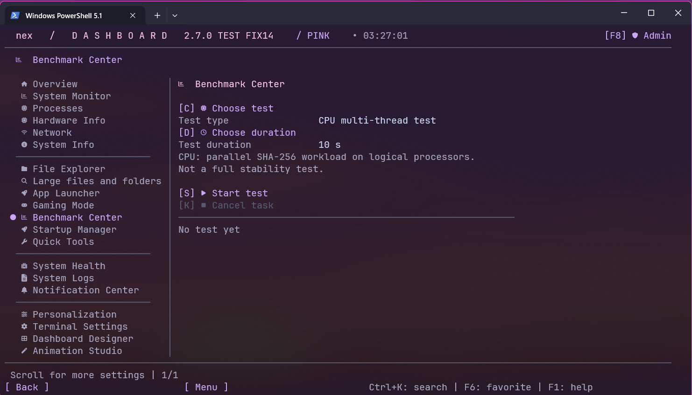 | 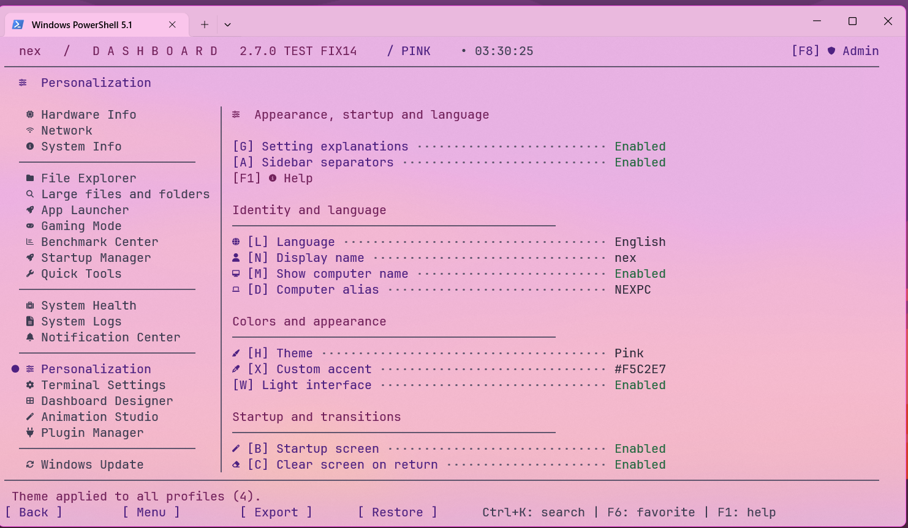 |

Vorschau auf 2.7.0 — Datei in Editor-Tab öffnen

### Große Dateien und Ordner

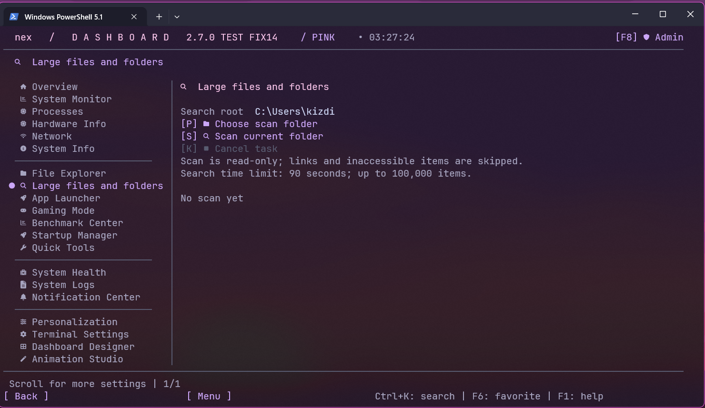

### Umbenennungsvorschau

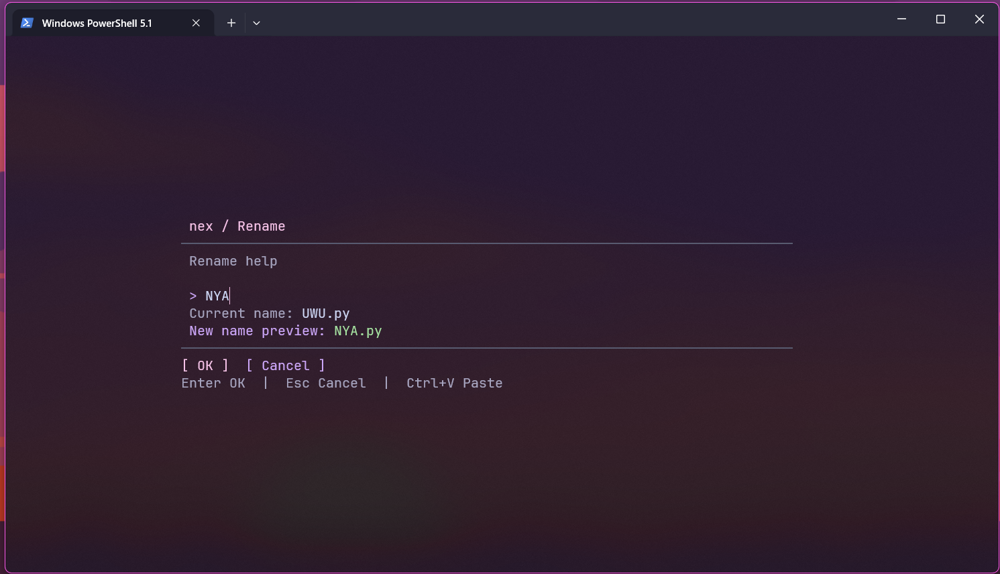

### Inline-Codevervollständigung

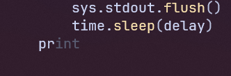

### Datei in Editor-Tab öffnen

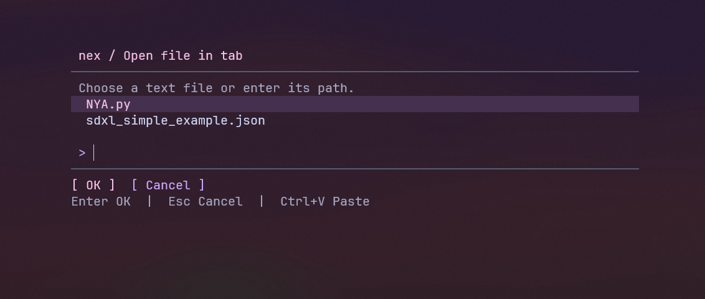

### Midnight Aurora im Hellmodus

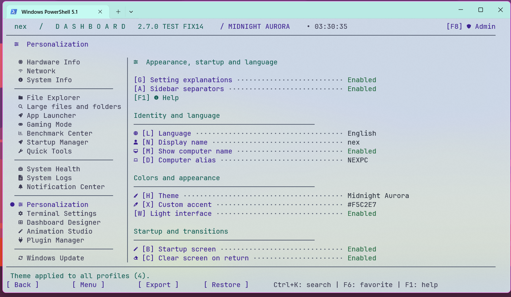

## Vorschau

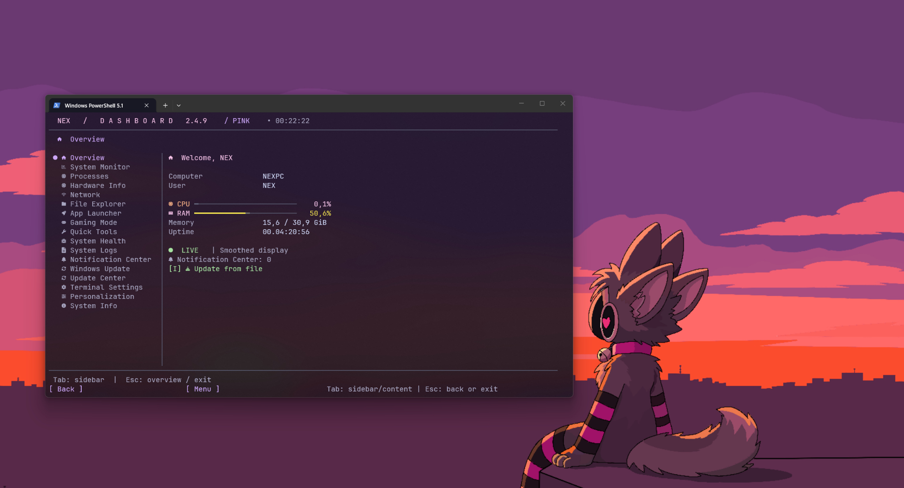

*Screenshots älterer Versionen; die aktuelle Oberfläche kann abweichen.*

Dashboard 2.6.0

### Systemmonitor
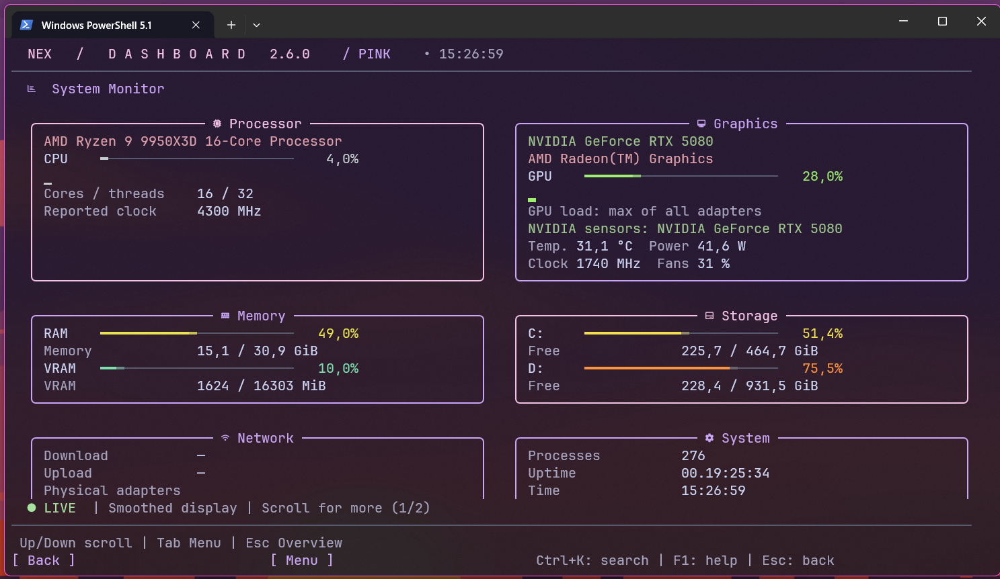

### Personalisierung
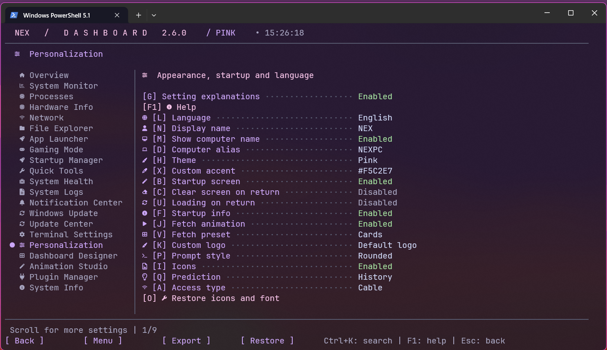

### Update-Center
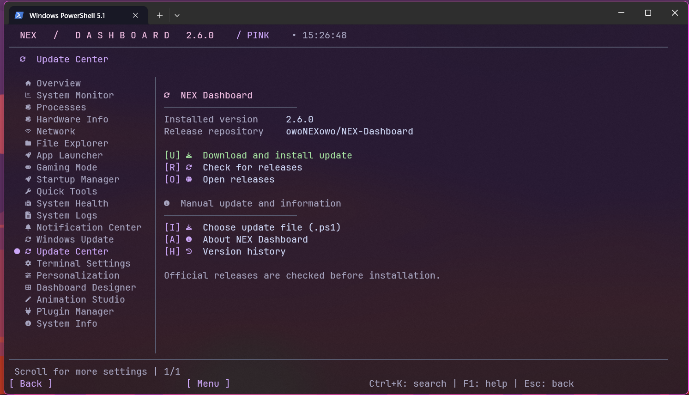

Weitere Funktionen — Screenshots aus Version 2.4.9

### Systeminformationen
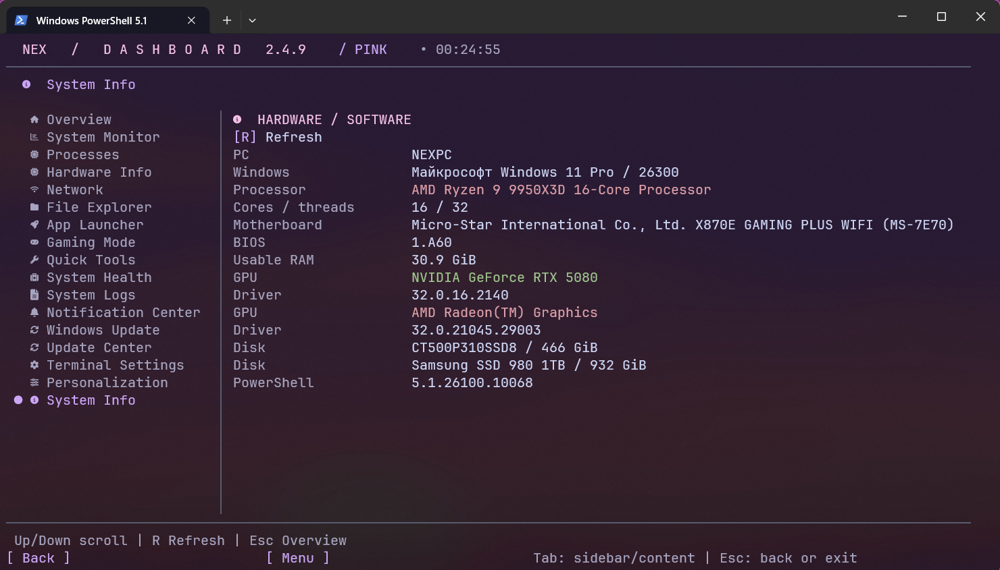

### Netzwerk
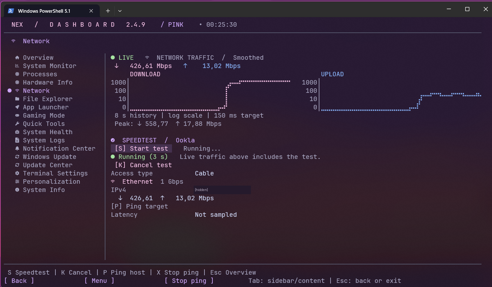

### Dateimanager
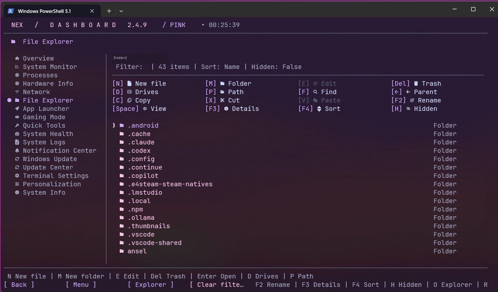

### Systemzustand
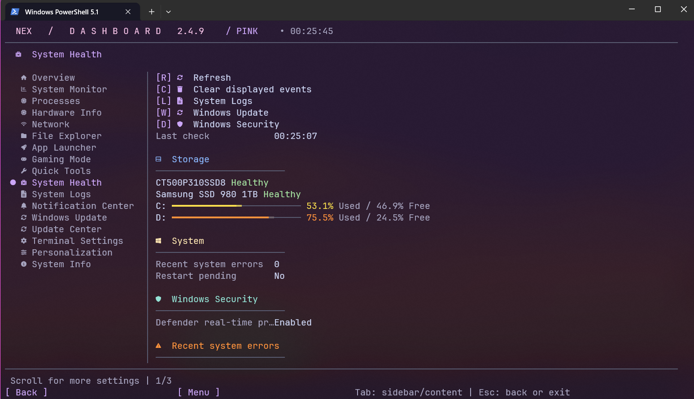

Fastfetch-Designs

### Karten

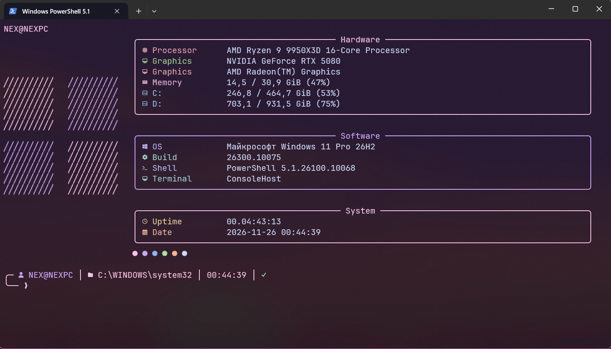

### Systemübersicht

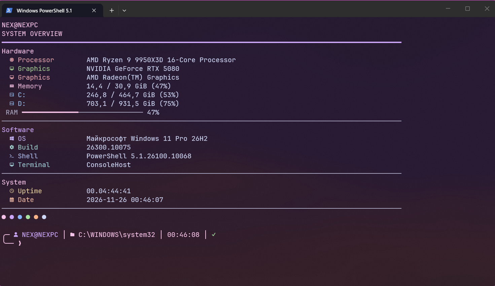

### Layout-Auswahl

Farbdesigns

### Mint & Glacier (2.4.9)

| Mint | Glacier |
| :---: | :---: |
| 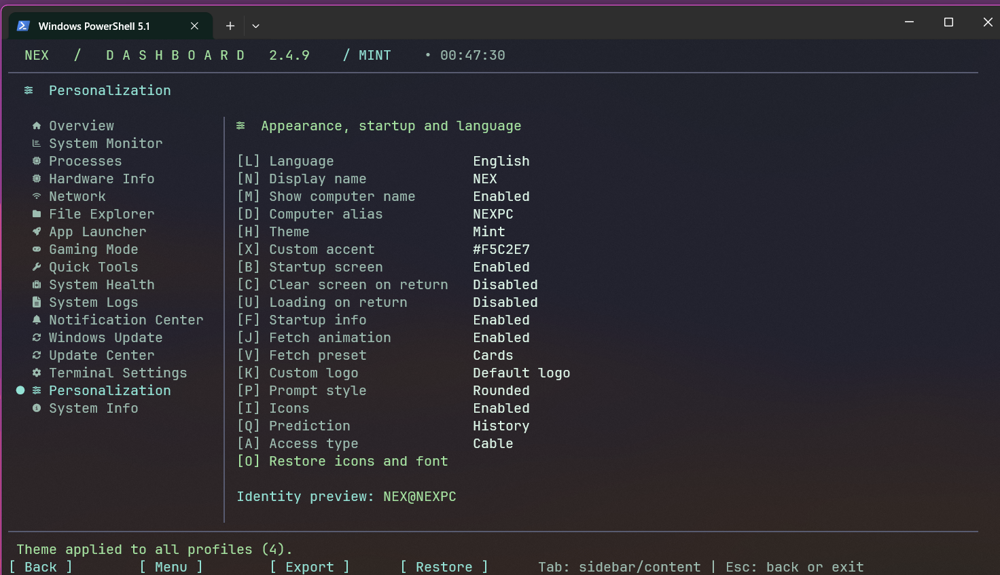 |  |

### Design-Auswahl

## Über NEX Dashboard

Ein anpassbares Dashboard für Windows PowerShell mit Hardware- und Netzwerküberwachung, 32 Farboptionen, Fastfetch-Layouts, Nerd-Font-Symbolen, Gaming-Modus, Energiesparplanverwaltung, Anwendungsstarter, Dateimanager, Systemdiagnose, Windows-Updates und Konfigurationssicherung.

## Vorherige Version: Neuerungen in 2.6.2

- Neu geordnetes Seitenmenü mit optionalen Trennlinien und gruppierten Personalisierungseinstellungen.
- Adaptive Beschriftungen und verbesserte Größenanpassung der Startkarten in unterstützten Konsolen.
- CPU-, RAM- und GPU-Metriken pro Prozess sowie eine Verknüpfung zum Windows-Ressourcenmonitor.
- Automatische Erkennung des lokalen Netzwerkadapters; Ookla-Zustimmung bleibt bei Dashboard-Updates erhalten.
- Getrennte Neustartanzeigen für Windows Update und Wartung.
- Automatische Syntax-, Layout- und Zustimmungstests für PowerShell 5.1 und 7.

Die Größenanpassung hängt von der Konsole und der PSReadLine-Version ab; lange oder mehrzeilige Eingaben werden nicht neu gezeichnet. Datenträger- und Netzwerkraten pro Prozess sind nicht enthalten.

## Neue Funktionen in 2.6.0

- **Dashboard-Designer:** Monitorkarten neu anordnen oder ausblenden, zwischen einer und zwei Spalten wählen und das Layout in der Vorschau ansehen.
- **Autostart-Manager:** Autostart-Programme und ihre Befehle anzeigen sowie die Windows-Autostart-Einstellungen öffnen.
- **Globale Suche:** mit `Ctrl+K` Dashboard-Bereiche und wichtige Aktionen finden.
- **Plugin-Manager:** integrierte Widgets für Akkustand, Sitzungsdauer und Schnellzugriffe aktivieren. Externe Skripte werden nicht ausgeführt.
- **Animationsstudio:** fünf Ladeanimationen, einstellbare Geschwindigkeit und Vorschau.
- **Kontexthilfe:** Erläuterungen in Einstellungsdialogen, Hilfe über `F1` und gepunktete Trennlinien in den Einstellungen.

**Installation:** EasyInstall-ZIP unter [Releases](https://github.com/owoNEXowo/NEX-Dashboard/releases) herunterladen, entpacken und `Install.cmd` starten. Dem Assistenten folgen.

**Updates:** ab Version 2.5.0 können kompatible veröffentlichte Releases über das Update-Center gesucht und installiert werden. Lokale `.ps1`-Updates bleiben möglich.

Öffentliche Version: Die Kompatibilität kann je nach PC und Terminal variieren. Installer nur aus vertrauenswürdigen Quellen ausführen.

---

[Fehler melden](https://github.com/owoNEXowo/NEX-Dashboard/issues)

Erstellt von **NEX**.

## Quellcode

[PowerShell-Quellcode](src/NexDashboard.ps1) · [Repository-Installer](installer/Install.cmd) · [Versionshistorie](CHANGELOG.md). Fertige Pakete sind unter [Releases](https://github.com/owoNEXowo/NEX-Dashboard/releases) verfügbar. Der NEX Dashboard-Quellcode steht unter der [MIT-Lizenz](LICENSE). Für Drittsoftware, Schriftarten und Logos gelten weiterhin ihre jeweiligen Lizenzen.
