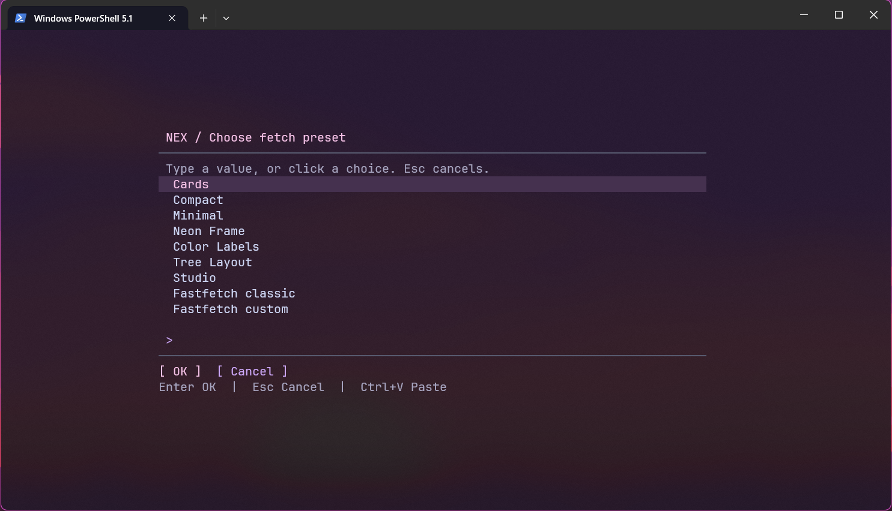
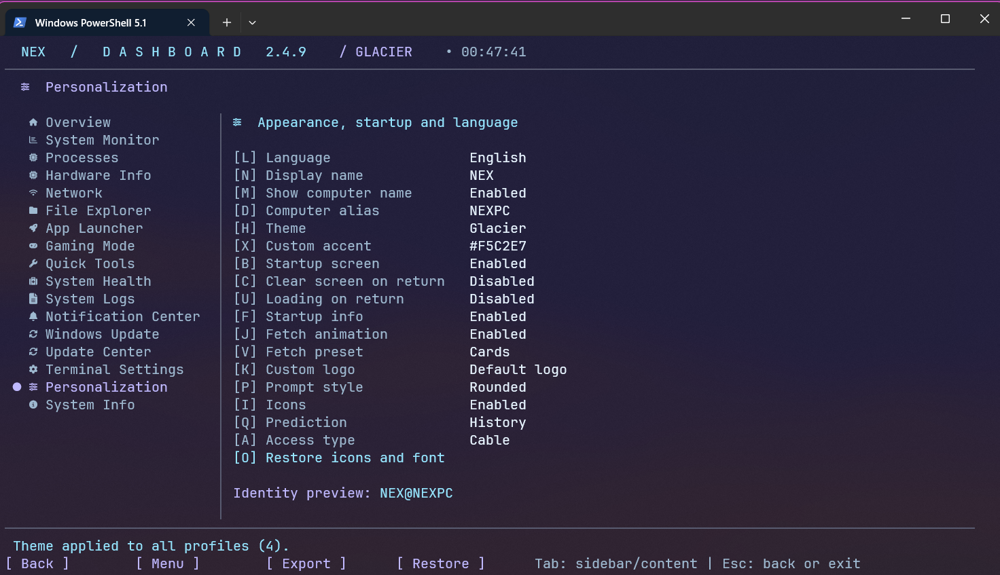
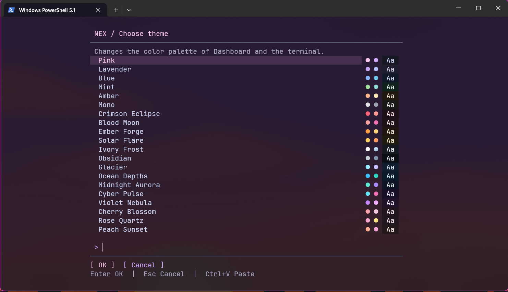

# NEX Dashboard

**Dein Terminal. Dein Stil. Deine Kontrolle.**

[English](README.md) · [Русский](README.ru.md) · **Deutsch**

## Vorschau

*Screenshots älterer Versionen; die aktuelle Oberfläche kann abweichen.*

Dashboard 2.6.0

### Systemmonitor

### Personalisierung

### Update-Center

Weitere Funktionen — Screenshots aus Version 2.4.9

### Systeminformationen

### Netzwerk

### Dateimanager

### Systemzustand

Fastfetch-Designs

### Karten

### Systemübersicht

### Layout-Auswahl

Farbdesigns

### Mint & Glacier (2.4.9)

| Mint | Glacier |
| :---: | :---: |
|  |  |

### Design-Auswahl

## Über NEX Dashboard

Ein anpassbares Dashboard für Windows PowerShell mit Hardware- und Netzwerküberwachung, 32 Farboptionen, Fastfetch-Layouts, Nerd-Font-Symbolen, Gaming-Modus, Energiesparplanverwaltung, Anwendungsstarter, Dateimanager, Systemdiagnose, Windows-Updates und Konfigurationssicherung.

## Neuerungen in 2.6.2

- Neu geordnetes Seitenmenü mit optionalen Trennlinien und gruppierten Personalisierungseinstellungen.
- Adaptive Beschriftungen und verbesserte Größenanpassung der Startkarten in unterstützten Konsolen.
- CPU-, RAM- und GPU-Metriken pro Prozess sowie eine Verknüpfung zum Windows-Ressourcenmonitor.
- Automatische Erkennung des lokalen Netzwerkadapters; Ookla-Zustimmung bleibt bei Dashboard-Updates erhalten.
- Getrennte Neustartanzeigen für Windows Update und Wartung.
- Automatische Syntax-, Layout- und Zustimmungstests für PowerShell 5.1 und 7.

Die Größenanpassung hängt von der Konsole und der PSReadLine-Version ab; lange oder mehrzeilige Eingaben werden nicht neu gezeichnet. Datenträger- und Netzwerkraten pro Prozess sind nicht enthalten.

## Neue Funktionen in 2.6.0

- **Dashboard-Designer:** Monitorkarten neu anordnen oder ausblenden, zwischen einer und zwei Spalten wählen und das Layout in der Vorschau ansehen.
- **Autostart-Manager:** Autostart-Programme und ihre Befehle anzeigen sowie die Windows-Autostart-Einstellungen öffnen.
- **Globale Suche:** mit `Ctrl+K` Dashboard-Bereiche und wichtige Aktionen finden.
- **Plugin-Manager:** integrierte Widgets für Akkustand, Sitzungsdauer und Schnellzugriffe aktivieren. Externe Skripte werden nicht ausgeführt.
- **Animationsstudio:** fünf Ladeanimationen, einstellbare Geschwindigkeit und Vorschau.
- **Kontexthilfe:** Erläuterungen in Einstellungsdialogen, Hilfe über `F1` und gepunktete Trennlinien in den Einstellungen.

**Installation:** EasyInstall-ZIP unter [Releases](https://github.com/owoNEXowo/NEX-Dashboard/releases) herunterladen, entpacken und `Install.cmd` starten. Dem Assistenten folgen.

**Updates:** ab Version 2.5.0 können kompatible veröffentlichte Releases über das Update-Center gesucht und installiert werden. Lokale `.ps1`-Updates bleiben möglich.

Öffentliche Version: Die Kompatibilität kann je nach PC und Terminal variieren. Installer nur aus vertrauenswürdigen Quellen ausführen.

---

[Fehler melden](https://github.com/owoNEXowo/NEX-Dashboard/issues)

Erstellt von **NEX**.

## Quellcode

[PowerShell-Quellcode](src/NexDashboard.ps1) · [Repository-Installer](installer/Install.cmd) · [Versionshistorie](CHANGELOG.md). Fertige Pakete sind unter [Releases](https://github.com/owoNEXowo/NEX-Dashboard/releases) verfügbar. Der NEX Dashboard-Quellcode steht unter der [MIT-Lizenz](LICENSE). Für Drittsoftware, Schriftarten und Logos gelten weiterhin ihre jeweiligen Lizenzen.
