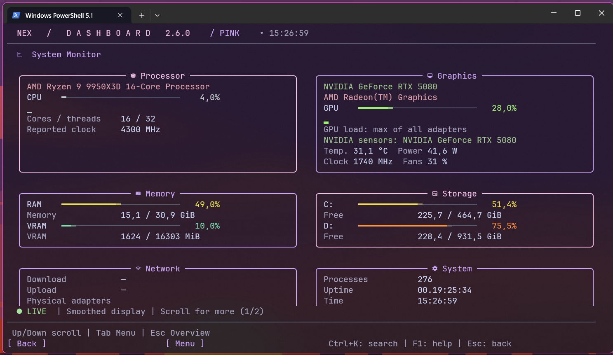
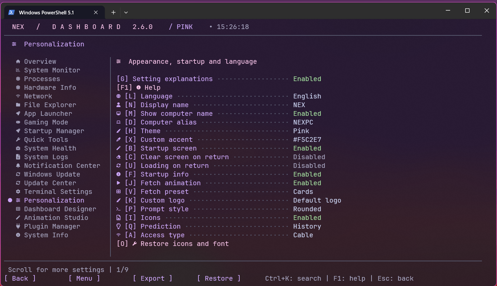
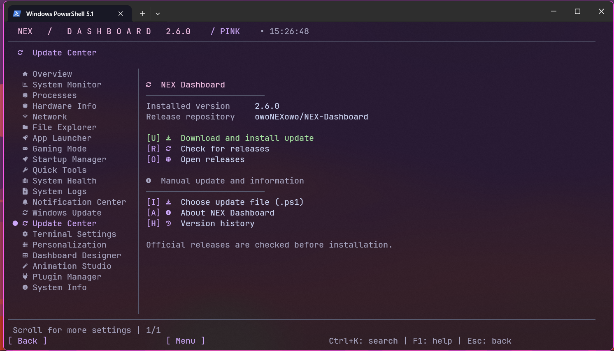
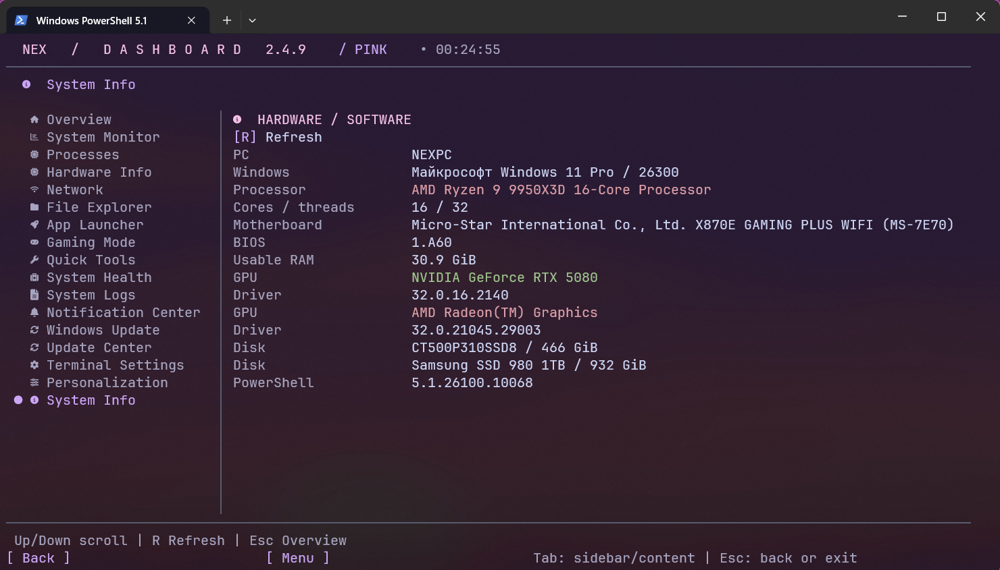
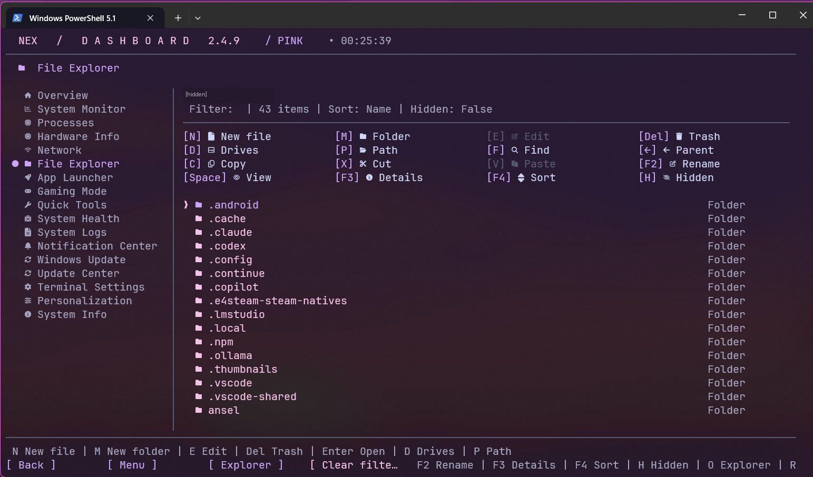
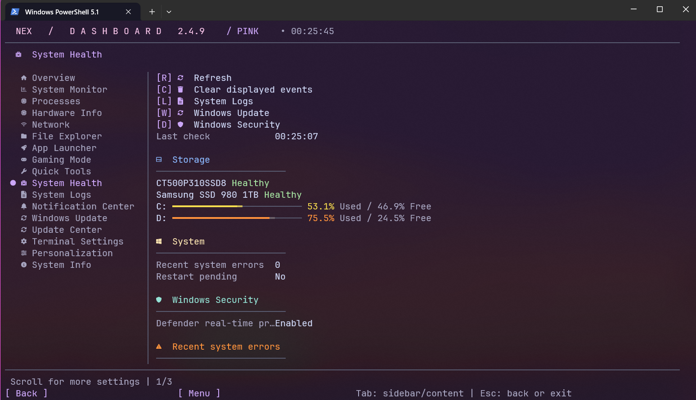
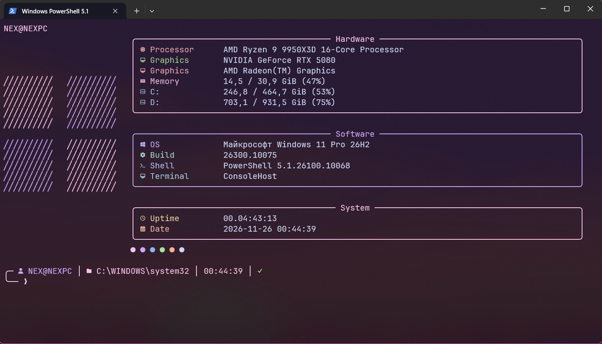
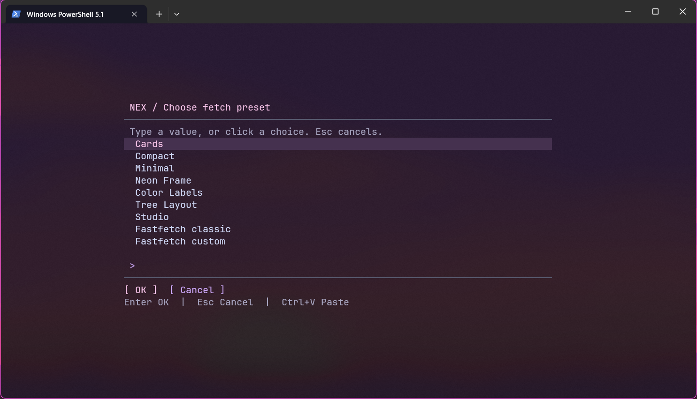
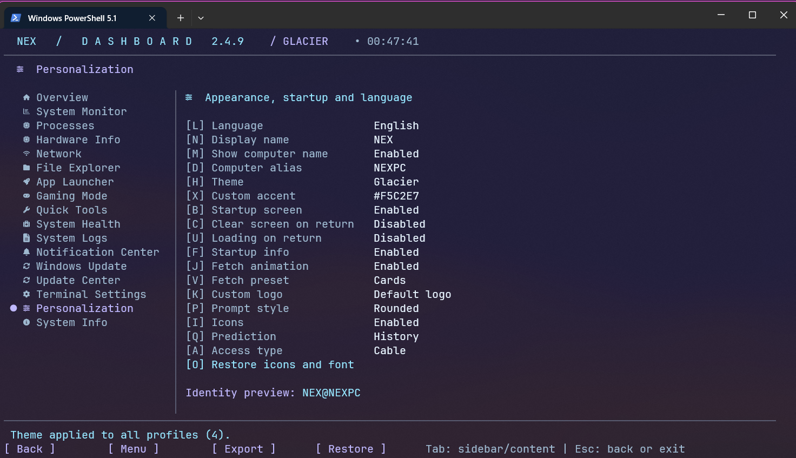
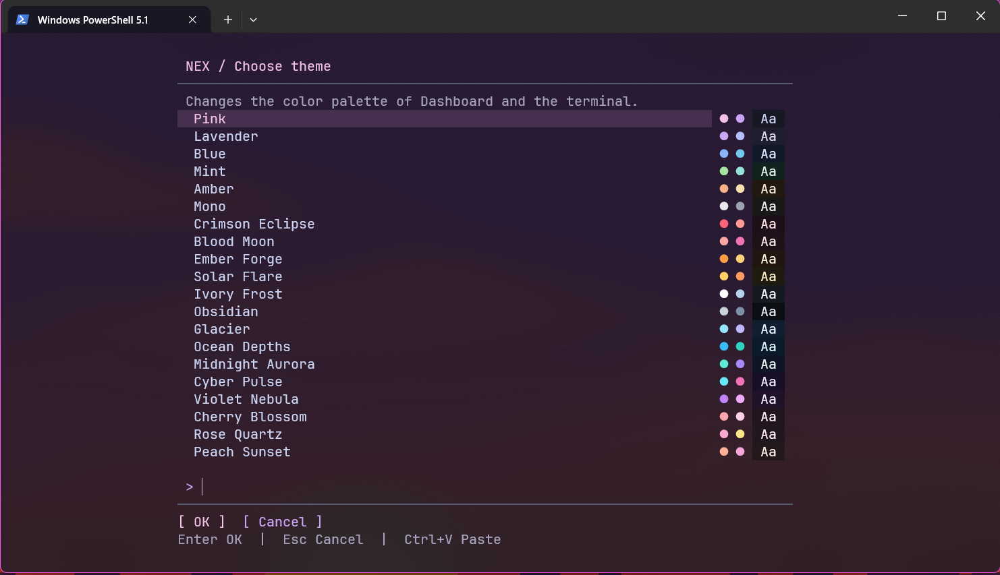

# NEX Dashboard

**Your terminal. Your style. Your control.**

**English** · [Русский](README.ru.md) · [Deutsch](README.de.md)

## Preview

Dashboard 2.6.0

### System Monitor

### Personalization

### Update Center

Other features — earlier screenshots (2.4.9)

### System Info

### Network

### File Explorer

### System Health

Fastfetch styles

### Cards

### System Overview

### Preset selector

Color themes

### Mint & Glacier (2.4.9)

| Mint | Glacier |
| :---: | :---: |
|  |  |

### Theme selector

## About NEX Dashboard

A customizable Windows PowerShell dashboard with live hardware and network monitoring, 32 color options, custom Fastfetch layouts, Nerd Font icons, gaming and power management, an app launcher, file explorer, system diagnostics, Windows updates and configuration backup.

## Features added in 2.6.0

- **Dashboard Designer:** reorder or hide monitor cards, choose one or two columns, and preview the layout.
- **Startup Manager:** inspect startup apps and their commands, and open Windows startup settings.
- **Global Search:** press `Ctrl+K` to find Dashboard sections and key actions.
- **Plugin Manager:** enable built-in battery, session time and shortcut widgets. No external scripts are executed.
- **Animation Studio:** choose from five loading animations, adjust speed and preview the result.
- **Contextual help:** explanations inside setting dialogs, `F1` help, and clearer dotted setting rows.

**Installation:** Download the EasyInstall ZIP from [Releases](https://github.com/owoNEXowo/NEX-Dashboard/releases), extract it and run `Install.cmd`. Follow the setup wizard.

**Updates:** from version 2.5.0 onward, use Update Center to check for and install compatible published releases. Local `.ps1` updates are still supported.

Public beta: bugs may occur. Only run installers from a trusted source.

---

[Feedback](https://github.com/owoNEXowo/NEX-Dashboard/issues)

Created by **NEX**.
