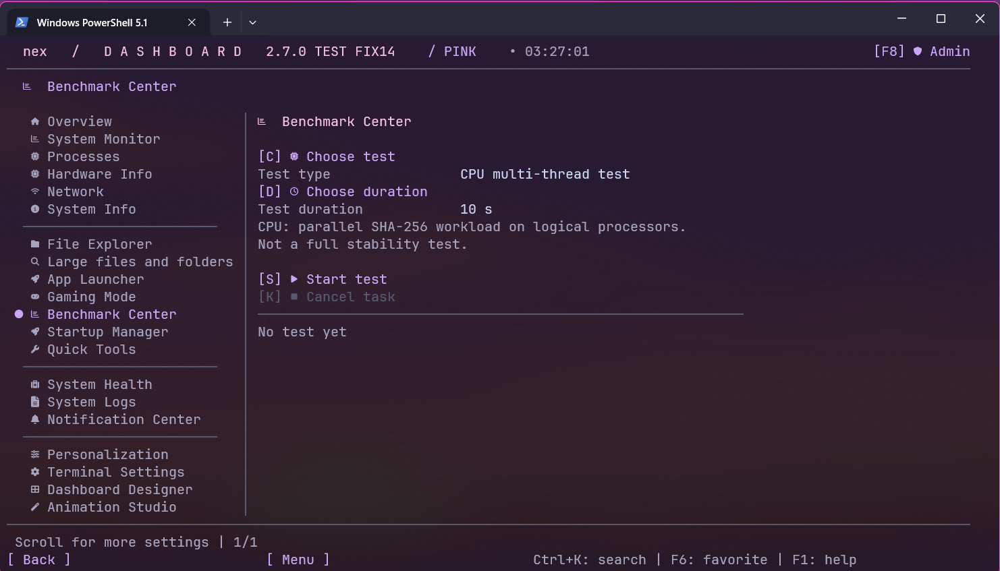
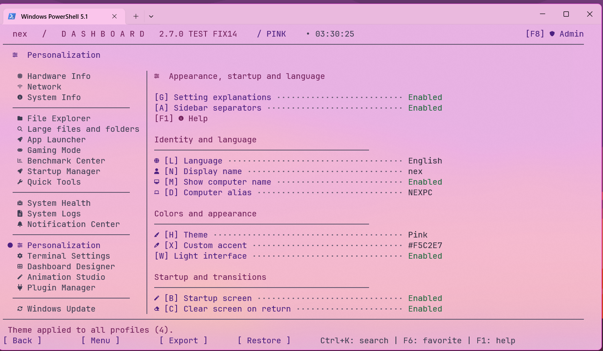
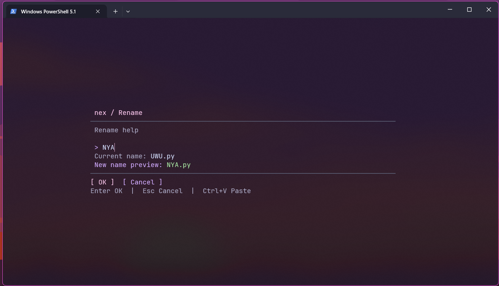
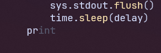
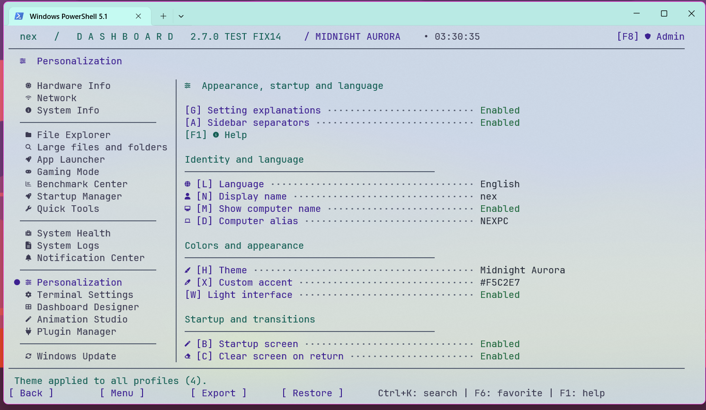
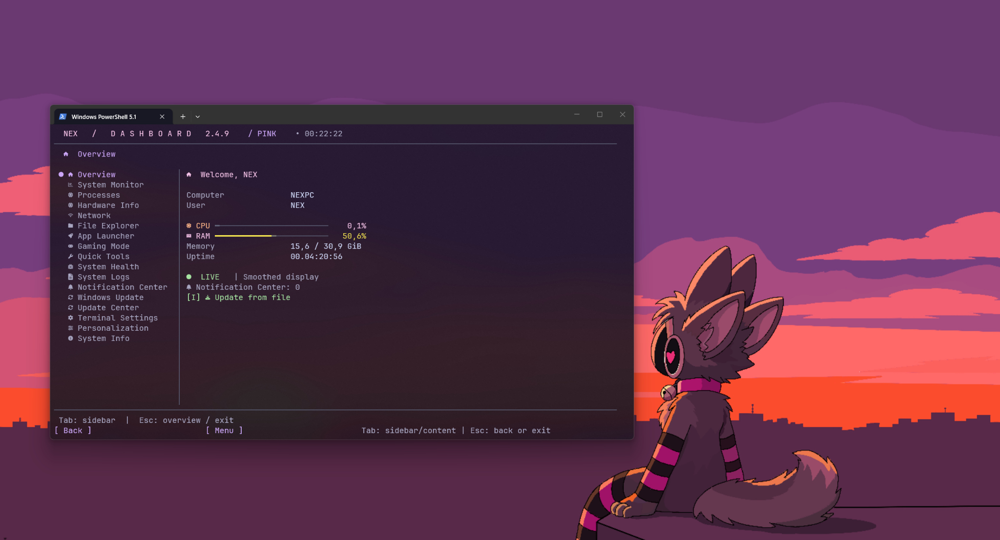
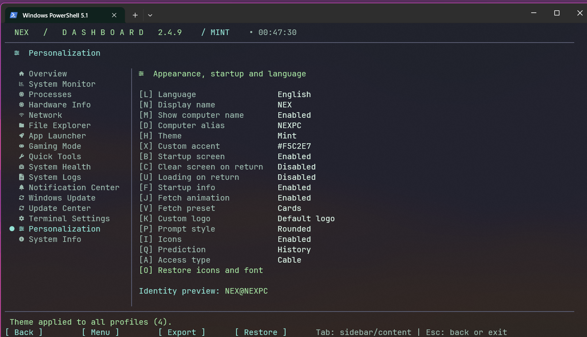

# NEX Dashboard

**Your terminal. Your style. Your control.**

**English** · [Русский](README.ru.md) · [Deutsch](README.de.md)

## What's new in 2.7.2

Need help? Open **F1 → Support and feedback** or find it using Ctrl+K. You can also use the NEX Update Center. GitHub opens in your browser; no reports or personal data are sent automatically.

[Report a bug](https://github.com/owoNEXowo/NEX-Dashboard/issues/new?template=bug_report.md) · [Suggest a feature](https://github.com/owoNEXowo/NEX-Dashboard/issues/new?template=feature_request.md) · [Share feedback](https://github.com/owoNEXowo/NEX-Dashboard/issues/new?template=feedback.md)

[2.7.2](docs/release-notes/2.7.2.md)

## What's new in 2.7.1

- Update Center now shows installer size, live download progress, and SHA-256 verification status.

[2.7.1](docs/release-notes/2.7.1.md)

## What's new in 2.7.0

- **Built-in Terminal Editor:** Tabs, syntax colors, search with match navigation, mouse selection, clipboard, undo/redo, auto-pairs, auto-indent, local inline completion, matching brackets and zoom/reset.
- **File Explorer:** Clickable breadcrumbs, extension-preserving rename with live preview, optional Windows “Open with” registration and the NEX icon.
- **Benchmarks and storage:** Time-limited CPU, RAM and GPU workloads with selectable memory budgets and reports; read-only search for large files and folders.
- **Personalization and monitoring:** Theme-derived light mode, favorites (F6), adaptive sidebar, compact layout, home blocks, draggable monitor cards, smoother indicators and new status widgets.
- **Diagnostics and updates:** Read-only full PC scan, backed-up settings reset, F8 privilege switch through a replacement Terminal window, background release check and animated update feedback.

Benchmarks are not a complete stability test. Available sensors and safe memory budgets depend on the hardware and drivers. Code completion is dictionary-based, not a full language server. Zoom and elevation depend on Windows Terminal; F8 uses Windows UAC and replaces the session, so save work first.

[2.7.0 release notes](docs/release-notes/2.7.0.md) · [Website](https://owonexowo.github.io/NEX-Dashboard/)

## 2.7.0 preview

Screenshots from the final FIX14 test build; the public version has the same interface without the TEST label.

| Benchmark Center | Pink light mode |
| :---: | :---: |
|  |  |

2.7.0 preview — Open file in editor tab

### Large files and folders

### Rename preview

### Inline code completion

### Open file in editor tab

### Midnight Aurora light mode

## Preview

*Earlier-version screenshots; current appearance may differ.*

Dashboard 2.6.0

### System Monitor

### Personalization

### Update Center

Other features — earlier screenshots (2.4.9)

### System Info

### Network

### File Explorer

### System Health

Fastfetch styles

### Cards

### System Overview

### Preset selector

Color themes

### Mint & Glacier (2.4.9)

| Mint | Glacier |
| :---: | :---: |
|  |  |

### Theme selector

## About NEX Dashboard

A customizable Windows PowerShell dashboard with live hardware and network monitoring, 32 color options, custom Fastfetch layouts, Nerd Font icons, gaming and power management, an app launcher, file explorer, system diagnostics, Windows updates and configuration backup.

## Previous release: what's new in 2.6.2

- Reorganized sidebar with optional group separators and grouped personalization settings.
- Adaptive information labels and improved startup card resizing for supported consoles.
- Live CPU, RAM and GPU process metrics, plus a Windows Resource Monitor shortcut.
- Automatic detection of local network adapter type; Ookla consent is remembered across Dashboard updates.
- Separate Windows Update and servicing restart indicators.
- Automated PowerShell 5.1 and 7 syntax, fetch layout and consent persistence tests.

The startup resize behavior depends on the console and PSReadLine version; long or multiline edits are not repainted. Per-process disk and network throughput are not included.

## Features added in 2.6.0

- **Dashboard Designer:** reorder or hide monitor cards, choose one or two columns, and preview the layout.
- **Startup Manager:** inspect startup apps and their commands, and open Windows startup settings.
- **Global Search:** press `Ctrl+K` to find Dashboard sections and key actions.
- **Plugin Manager:** enable built-in battery, session time and shortcut widgets. No external scripts are executed.
- **Animation Studio:** choose from five loading animations, adjust speed and preview the result.
- **Contextual help:** explanations inside setting dialogs, `F1` help, and clearer dotted setting rows.

**Installation:** Download the EasyInstall ZIP from [Releases](https://github.com/owoNEXowo/NEX-Dashboard/releases), extract it and run `Install.cmd`. Follow the setup wizard.

**Updates:** from version 2.5.0 onward, use Update Center to check for and install compatible published releases. Local `.ps1` updates are still supported.

Public release: compatibility may vary by PC and terminal. Only run installers from a trusted source.

---

[Feedback](https://github.com/owoNEXowo/NEX-Dashboard/issues)

Created by **NEX**.

## Source code

[PowerShell source](src/NexDashboard.ps1) · [Repository installer](installer/Install.cmd) · [Changelog](CHANGELOG.md). Ready-to-use builds remain in [Releases](https://github.com/owoNEXowo/NEX-Dashboard/releases). The NEX Dashboard source code is licensed under the [MIT License](LICENSE). Third-party software, fonts and logos remain under their respective licenses; they are not relicensed here.
