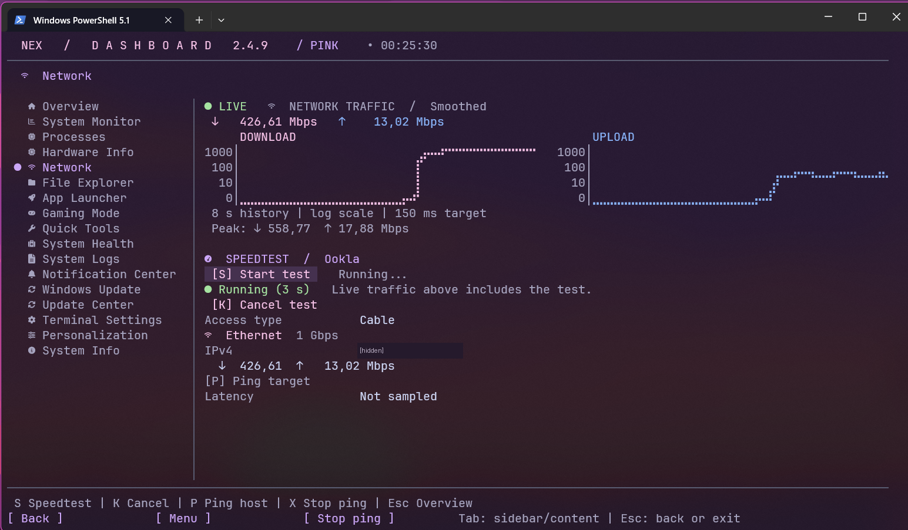
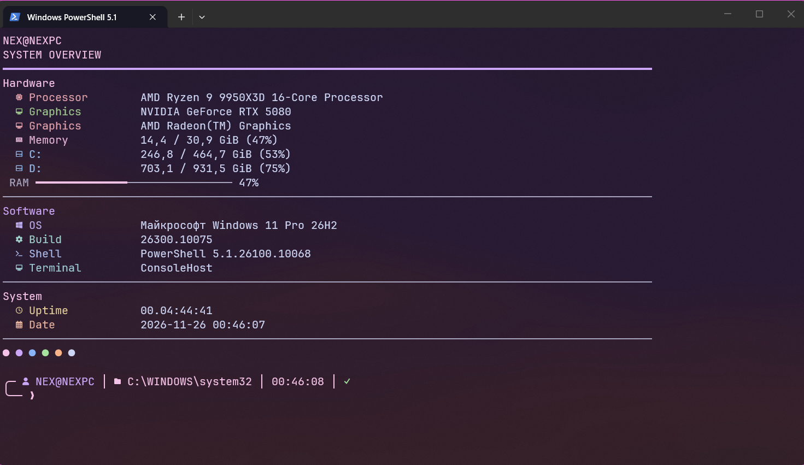

# NEX Dashboard

**Your terminal. Your style. Your control.**

[English](#english) · [Русский](#русский) · [Deutsch](#deutsch)

## Preview

More screenshots / Больше скриншотов / Weitere Screenshots

### System Monitor

### System Info

### Network

### File Explorer

### System Health

Fastfetch styles / Стили Fastfetch / Fastfetch-Designs

### Cards

### System Overview

### Preset selector

Color themes / Цветовые темы / Farbdesigns

### Mint & Glacier

| Mint | Glacier |
| :---: | :---: |
|  |  |

### Theme selector

## English

A customizable Windows PowerShell dashboard with live hardware and network monitoring, 32 color options, custom Fastfetch layouts, Nerd Font icons, gaming and power management, an app launcher, file explorer, system diagnostics, Windows updates and configuration backup.

**Installation:** Download the EasyInstall ZIP from [Releases](https://github.com/owoNEXowo/NEX-Dashboard/releases), extract it and run `Install.cmd`. Follow the setup wizard.

Public beta: bugs may occur. Only run installers from a trusted source.

## Русский

Настраиваемый Dashboard для Windows PowerShell: мониторинг комплектующих и сети, 32 варианта оформления, стили Fastfetch, иконки Nerd Font, игровой режим, управление электропитанием, запуск приложений, проводник, диагностика, обновления Windows и сохранение конфигураций.

**Установка:** скачайте архив EasyInstall из [Releases](https://github.com/owoNEXowo/NEX-Dashboard/releases), распакуйте его и запустите `Install.cmd`. Следуйте инструкциям мастера.

Публичная бета-версия: возможны ошибки. Запускайте установщики только из доверенных источников.

## Deutsch

Ein anpassbares Dashboard für Windows PowerShell mit Hardware- und Netzwerküberwachung, 32 Farboptionen, Fastfetch-Layouts, Nerd-Font-Symbolen, Gaming-Modus, Energiesparplanverwaltung, Anwendungsstarter, Dateimanager, Systemdiagnose, Windows-Updates und Konfigurationssicherung.

**Installation:** EasyInstall-ZIP unter [Releases](https://github.com/owoNEXowo/NEX-Dashboard/releases) herunterladen, entpacken und `Install.cmd` starten. Dem Assistenten folgen.

Öffentliche Beta: Fehler sind möglich. Installer nur aus vertrauenswürdigen Quellen ausführen.

---

[Feedback / Сообщить об ошибке / Fehler melden](https://github.com/owoNEXowo/NEX-Dashboard/issues)

Created by **NEX**.
