

# NEX Dashboard

**Твой терминал. Твой стиль. Твой контроль.**

[English](README.md) · **Русский** · [Deutsch](README.de.md)

## Предпросмотр

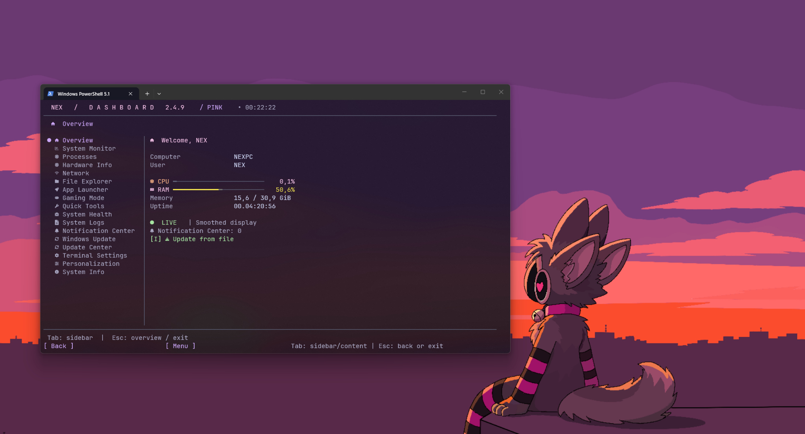

*Скриншоты предыдущих версий; текущий интерфейс может отличаться.*

Dashboard 2.6.0

### Монитор системы
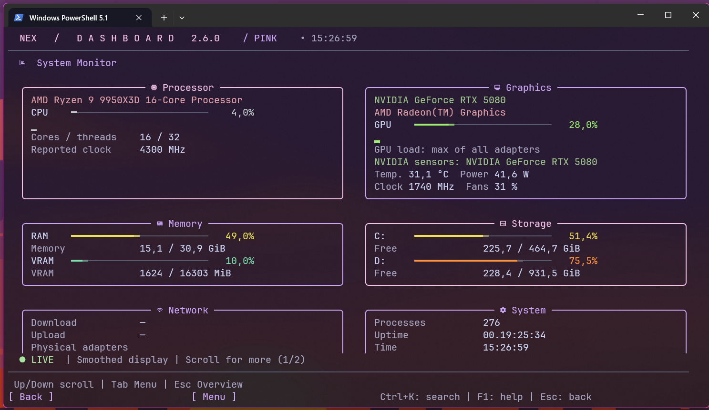

### Персонализация
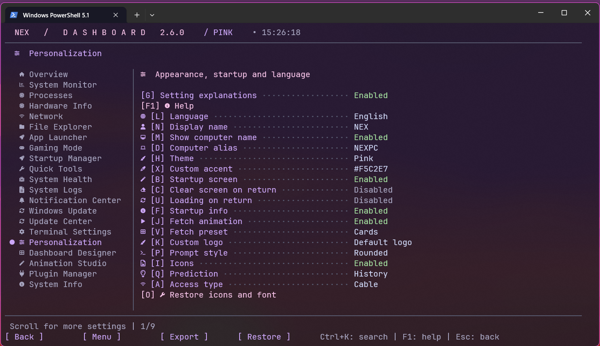

### Центр обновлений
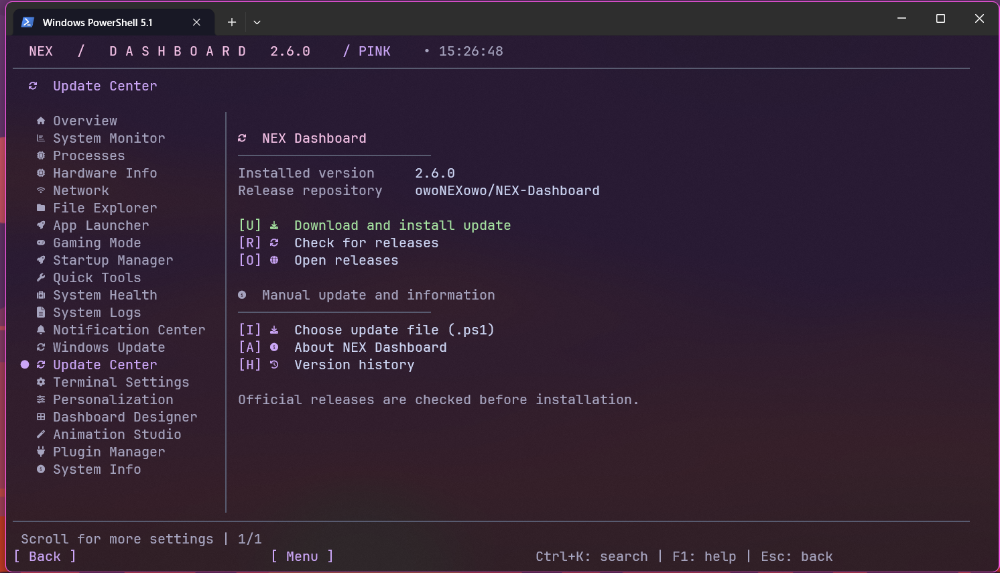

Другие функции — скриншоты версии 2.4.9

### О системе

### Сеть
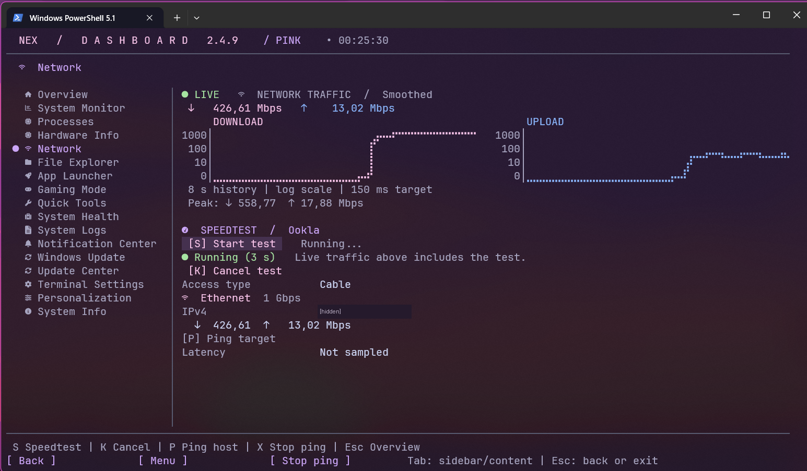

### Проводник
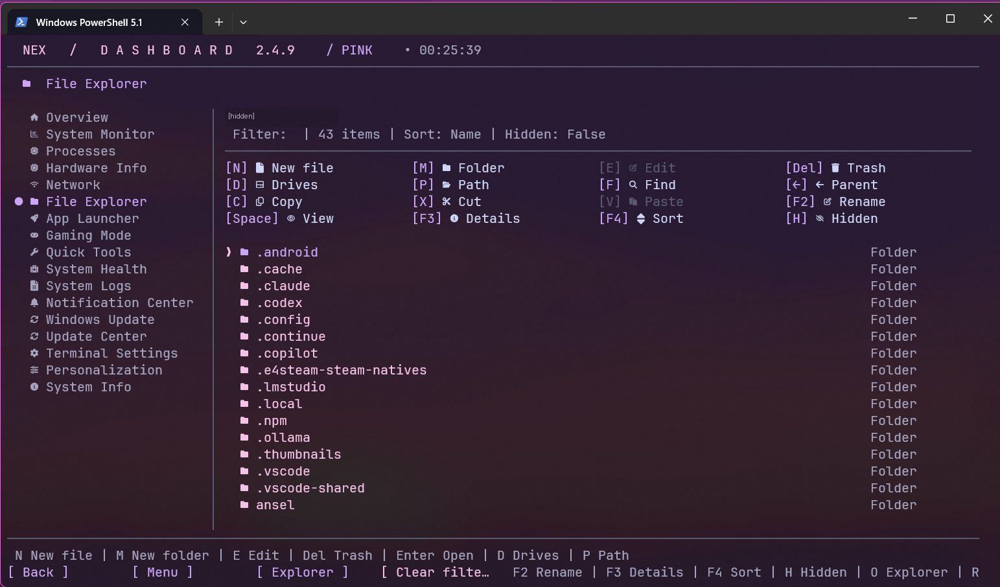

### Состояние системы
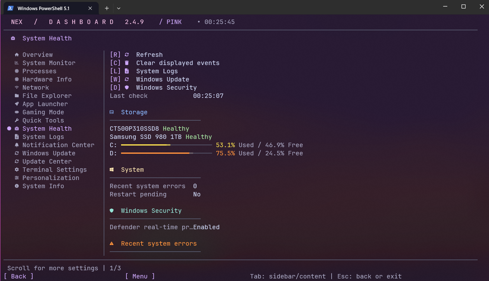

Стили Fastfetch

### Карточки

### Обзор системы

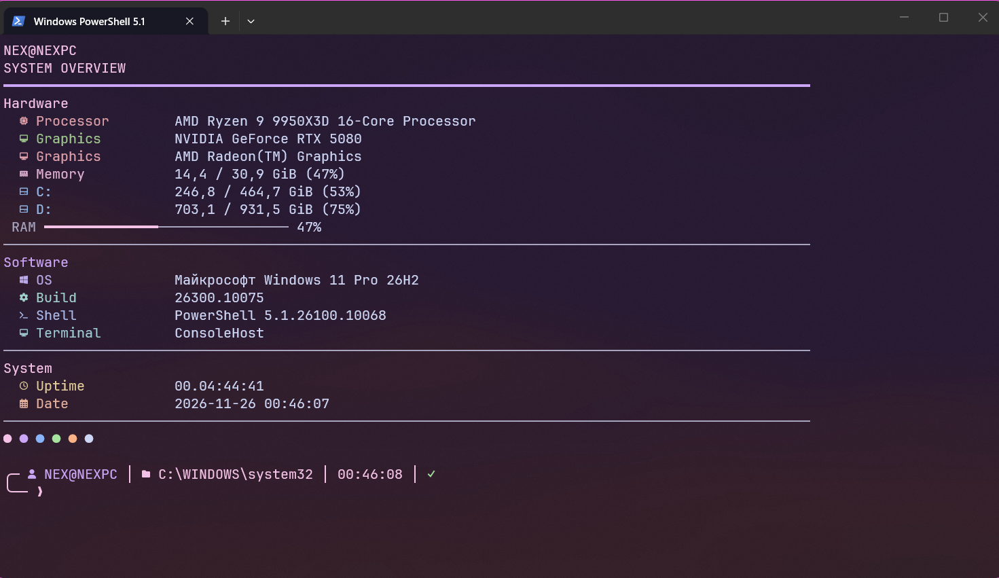

### Выбор пресета

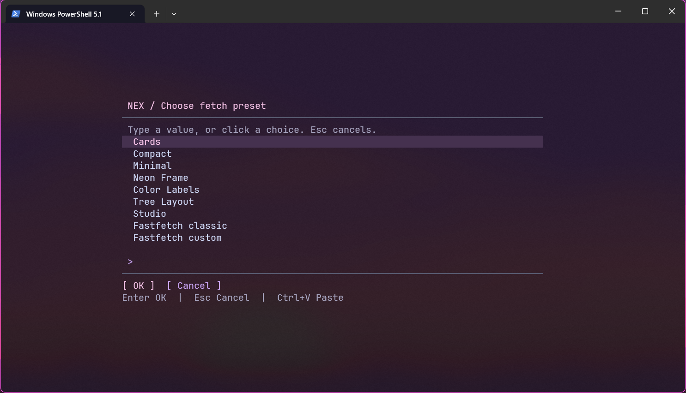

Цветовые темы

### Mint и Glacier (2.4.9)

| Mint | Glacier |
| :---: | :---: |
| 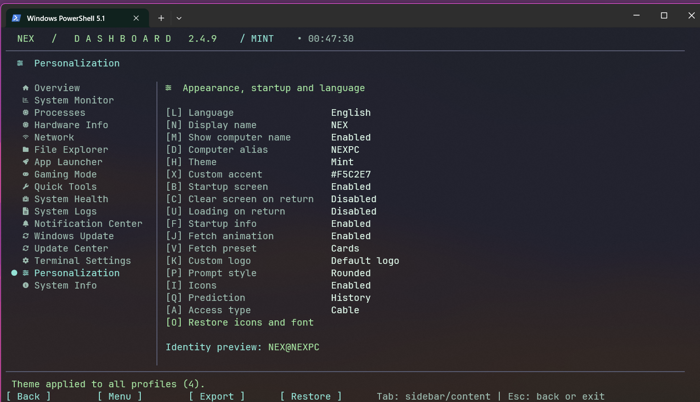 | 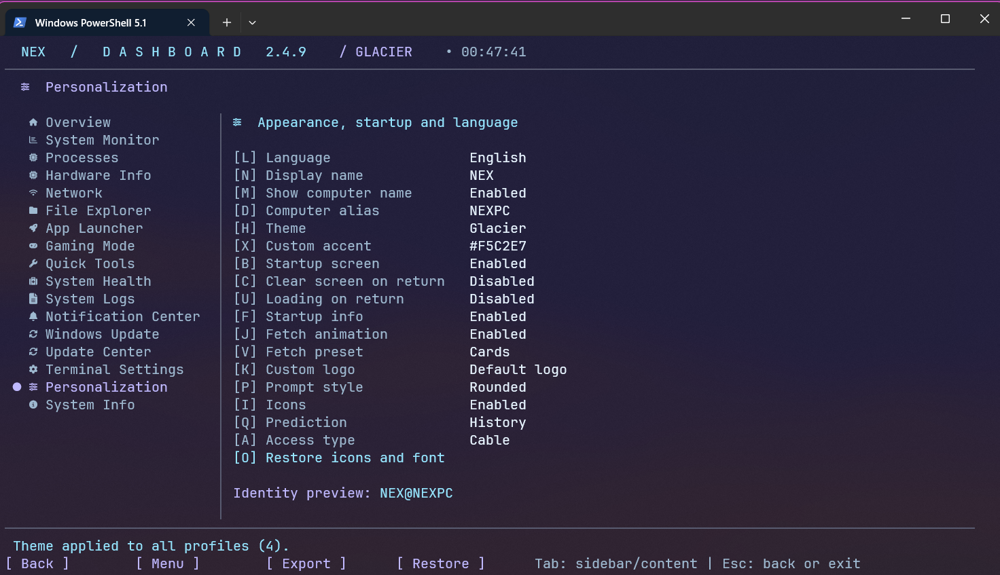 |

### Выбор темы

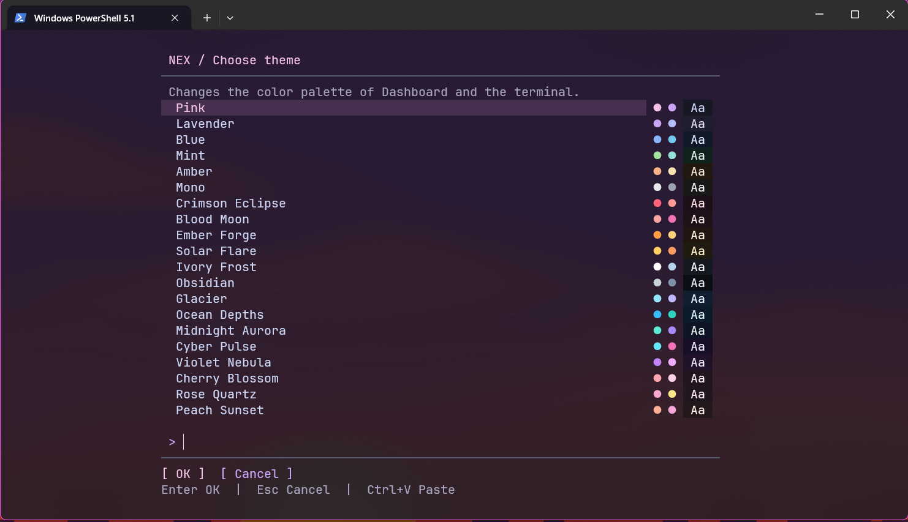

## О NEX Dashboard

Настраиваемый Dashboard для Windows PowerShell: мониторинг комплектующих и сети, 32 варианта оформления, стили Fastfetch, иконки Nerd Font, игровой режим, управление электропитанием, запуск приложений, проводник, диагностика, обновления Windows и сохранение конфигураций.

## Что нового в 2.6.2

- Упорядоченное боковое меню с отключаемыми разделителями и группы персонализации.
- Адаптивные подписи и улучшенное изменение размеров стартовых карточек в поддерживаемых терминалах.
- Мониторинг CPU, RAM и GPU по процессам и кнопка открытия монитора ресурсов Windows.
- Автоматическое определение локального сетевого адаптера и сохранение согласия Ookla при обновлении Dashboard.
- Раздельные индикаторы перезапуска Windows Update и системного обслуживания.
- Автоматические тесты синтаксиса, ширины карточек и сохранения согласия в PowerShell 5.1 и 7.

Перерисовка стартовых карточек зависит от терминала и версии PSReadLine; длинные и многострочные команды не перерисовываются. Скорость диска и сети по процессам не предусмотрена.

## Новые возможности 2.6.0

- **Дизайнер Dashboard:** меняйте порядок карточек монитора, скрывайте ненужные, выбирайте одну или две колонки и просматривайте результат.
- **Автозагрузка:** просмотр программ автозагрузки и их команд, переход к настройкам Windows.
- **Глобальный поиск:** нажмите `Ctrl+K`, чтобы найти разделы и основные действия.
- **Менеджер плагинов:** встроенные виджеты батареи, времени сеанса и быстрых ярлыков. Внешние скрипты не запускаются.
- **Студия анимаций:** пять вариантов загрузки, настройка скорости и предпросмотр.
- **Контекстная помощь:** пояснения в окнах выбора настроек, справка по `F1` и точечные разделители между названиями и значениями.

**Установка:** скачайте архив EasyInstall из [Releases](https://github.com/owoNEXowo/NEX-Dashboard/releases), распакуйте его и запустите `Install.cmd`. Следуйте инструкциям мастера.

**Обновления:** начиная с версии 2.5.0 используйте центр обновлений для проверки и установки совместимых опубликованных релизов. Установка из локального `.ps1` также поддерживается.

Публичный релиз: совместимость зависит от ПК и терминала. Запускайте установщики только из доверенных источников.

---

[Сообщить об ошибке](https://github.com/owoNEXowo/NEX-Dashboard/issues)

Создатель **NEX**.

## Исходный код

[Скрипт PowerShell](src/NexDashboard.ps1) · [Установщик репозитория](installer/Install.cmd) · [История версий](CHANGELOG.md). Готовые сборки находятся в [Releases](https://github.com/owoNEXowo/NEX-Dashboard/releases). Исходный код NEX Dashboard распространяется по [лицензии MIT](LICENSE). Сторонние программы, шрифты и логотипы сохраняют собственные лицензии.
