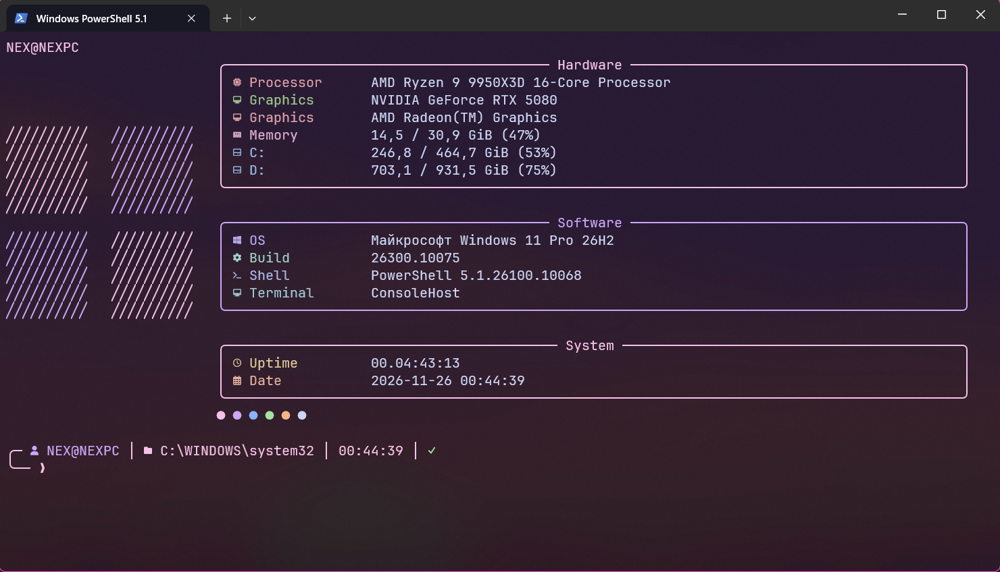

# NEX Dashboard

**Твой терминал. Твой стиль. Твой контроль.**

[English](README.md) · **Русский** · [Deutsch](README.de.md)

## Предпросмотр

Больше скриншотов

### Монитор системы

### О системе

### Сеть

### Проводник

### Состояние системы

Стили Fastfetch

### Карточки

### Обзор системы

### Выбор пресета

Цветовые темы

### Mint & Glacier

| Mint | Glacier |
| :---: | :---: |
|  |  |

### Выбор темы

## О NEX Dashboard

Настраиваемый Dashboard для Windows PowerShell: мониторинг комплектующих и сети, 32 варианта оформления, стили Fastfetch, иконки Nerd Font, игровой режим, управление электропитанием, запуск приложений, проводник, диагностика, обновления Windows и сохранение конфигураций.

## Новые возможности 2.6.0

- **Дизайнер Dashboard:** меняйте порядок карточек монитора, скрывайте ненужные, выбирайте одну или две колонки и просматривайте результат.
- **Автозагрузка:** просмотр программ автозагрузки и их команд, переход к настройкам Windows.
- **Глобальный поиск:** нажмите `Ctrl+K`, чтобы найти разделы и основные действия.
- **Менеджер плагинов:** встроенные виджеты батареи, времени сеанса и быстрых ярлыков. Внешние скрипты не запускаются.
- **Студия анимаций:** пять вариантов загрузки, настройка скорости и предпросмотр.
- **Пояснения к настройкам:** отключаемые подсказки и справка по `F1`.

**Установка:** скачайте архив EasyInstall из [Releases](https://github.com/owoNEXowo/NEX-Dashboard/releases), распакуйте его и запустите `Install.cmd`. Следуйте инструкциям мастера.

**Обновления:** начиная с версии 2.5.0 используйте центр обновлений для проверки и установки совместимых опубликованных релизов. Установка из локального `.ps1` также поддерживается.

Публичная бета-версия: возможны ошибки. Запускайте установщики только из доверенных источников.

---

[Сообщить об ошибке](https://github.com/owoNEXowo/NEX-Dashboard/issues)

Создатель **NEX**.
